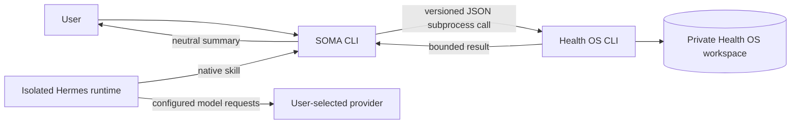

# Architecture and first scenario

## Boundary

SOMA owns the local command-line entry point, interaction, response presentation, and integration policy. Health OS owns structured health data, deterministic calculations, workspace storage, and provider connectors. Personal records stay in a private Health OS workspace outside both repositories.

Hermes source is pinned in `third_party/hermes-agent`. SOMA's runtime adapter selects the manifest under `runtimes/`, installs it into an explicitly configured external `SOMA_RUNTIME_HOME`, and sets Hermes' home to its `hermes-home` child. It does not search for or import an existing Hermes profile. The runtime is swappable through the provider interface; Health OS remains a separate data engine.

SOMA calls Health OS as a subprocess using its public CLI. It passes explicit repository and workspace paths, checks the pinned Health OS revision and schema, validates the JSON envelope, and maps the result into a bounded response contract. It must not import Health OS `src/*` internals or copy the engine into SOMA. The preparation command is read-only for health-domain records, though SQLite may create or update auxiliary WAL/SHM files in the private workspace. The pinned commit is this adapter's reviewed compatibility target, not a latest-release claim.

The separate `health-action` entry point is allowlisted: it can retrieve the manifest-selected profile through native `profile-show`, read workout history through native `timeline`, record a user-requested workout through native `log-workout`, and update a working weight through native `set-working-weight`. It does not expose arbitrary Health OS commands. Profile/history JSON is private; human summaries omit its content. Profile and timeline bounds remain explicit. Outer envelope truncation and malformed or unmarked missing fields fail closed. Native timeline item `data_truncated` metadata is handled as an explicit partial result: its workout body is discarded, and count/date metadata may guide narrowing but can never support an available latest workout. The latest-workout path uses a single complete timeline result when history fits the native 50-row bound; larger or content-truncated histories use date narrowing with count and latest-day rechecks. The fallback is a nontransactional consistency check, not one atomic snapshot. Latest lookup requires an explicit `--through` date from the configured local calendar; callers obtain it from the runtime/system timezone (for example, `date +%F`) and pass it through. SOMA does not infer a UTC date. Writes require both `SOMA_HEALTH_ACTION_MODE=confirmed-writes` from operator configuration and the action's explicit request marker, plus an idempotency key. The mode defaults to read-only and is never selectable by skill/user command arguments. This is an application workflow guard, not an OS sandbox or tamper-proof boundary; the operator controls the service configuration. Transport, malformed response, and journal uncertainty are surfaced as unknown outcomes and are never silently retried.

## First scenario

The manual vertical is:

1. `doctor` checks that the expected Health OS checkout and workspace are available.
2. `init` explicitly creates a neutral workspace when the configured destination is absent or empty.
3. `prepare-training --as-of <RFC3339>` requests a bounded preparation result for one instant.
4. SOMA presents the plan, rationale, recovery status, sources, and gaps.

`prepare-training` is read-only with respect to health-domain records. A successful result uses the SOMA JSON envelope `{ schema_version, command, ok, data }`. The JSON response includes the selected profile as an exact excerpt capped at 2,000 characters, up to eight subjective facts/signals of each kind, and up to three memory excerpts capped at 500 characters each. Their provenance, review status, dates, and truncation flags are preserved. Missing, empty, or blocked memory never forwards evidence. The default human-readable formatter does not print these private excerpts. Recovery includes bounded status, mode, reason codes, and a deterministic explanation; an explanation may cite a derived decision factor but does not expose raw measurements. The exact machine contract is defined by the implementation.

An RFC3339 cutoff includes an explicit timezone offset and represents one exact instant. Date-only values are rejected. Omitting the cutoff selects the current exact instant. When recovery is unavailable, SOMA must retain the `scheduled_only` status and explain that the listed workout is a schedule candidate, not a recovery-supported recommendation. Gaps remain visible; SOMA does not infer missing values.

For the exact Health OS CLI, JSON, and workspace contracts, see the pinned [agent integration runbook](https://github.com/bknstn/health-os/blob/5cb3a648f983a2ac10cd9a8d3583c06a3083a5d3/docs/agent-integration-runbook.md) and [framework/workspace guide](https://github.com/bknstn/health-os/blob/5cb3a648f983a2ac10cd9a8d3583c06a3083a5d3/docs/framework-and-workspace.md).

## Configuration

The supported configuration is explicit and small:

| Variable | Purpose |
| --- | --- |
| `HEALTH_OS_REPO` | Absolute path to the Health OS checkout at the pinned revision |
| `HEALTH_OS_WORKSPACE` | Absolute path to the private workspace, outside both repositories |
| `SOMA_HEALTH_ACTION_MODE` | Operator-only write gate: `read-only` by default or `confirmed-writes` after workspace ownership is transferred |

The CLI also accepts path flags that take precedence over environment values. SOMA does not discover private workspaces, select a personal profile by searching filenames, or read owner data from another application.

Hermes adds `SOMA_RUNTIME=hermes` and a new absolute `SOMA_RUNTIME_HOME`, separate from both repositories and any existing `~/.hermes` directory. `npm run runtime:setup` installs the pinned module, `npm run runtime:doctor` checks it without calling Health OS, and `npm run chat` launches it. See [Hermes runtime setup](hermes.md).

## Runtime and future model layer

Hermes invokes the SOMA CLI through the native skill. The first vertical also runs directly from the command line; it is deterministic and requires no model credential. Chat requires the provider configured in the isolated Hermes home. The runtime adapter preserves the same explicit data boundary and reports unavailable inputs without guessing.

## Replace the runtime

Runtime provider modules live under `src/runtime/providers/`; `createRuntimeManager()` in `src/runtime/manager.js` registers the supported modules. A provider's `name` must match its registry key, `sourceRevision` records its pin, `setup(context)` installs it, `inspect(context)` returns an object whose `ready` boolean describes whether it can launch, and `launch({ action, args, context })` returns `{ executable, args, cwd? }`. The manager starts that argv with `shell: false` and requires any working directory to stay inside the isolated runtime home.

Providers may also define `environment(context)` to add non-protected variables, `forbiddenHomes` to prevent overlap with another profile, `validateLaunch({ action, args, context })` to enforce supported operations, and `chatCredentialEnv` to allowlist secrets for chat only. `RuntimeManager.installProviderDependencies(name)` routes only the provider's validated `provider-dependencies` action; each provider maps that bounded name to its pinned package manager. Provider output is reduced to safe status fields. To add or replace an implementation, register and pin its module before selecting it with `SOMA_RUNTIME=<registered-name>`; changing the variable alone does not install or register a runtime. Run `runtime:setup` for that selected provider and give it a new explicit `SOMA_RUNTIME_HOME`.
