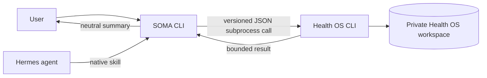

# Architecture and first scenario

## Boundary

SOMA owns the local command-line entry point, interaction, response presentation, and integration policy. Health OS owns structured health data, deterministic calculations, workspace storage, and provider connectors. Personal records stay in a private Health OS workspace outside both repositories.

SOMA calls Health OS as a subprocess using its public CLI. It passes explicit repository and workspace paths, checks the pinned Health OS revision and schema, validates the JSON envelope, and summarizes only the first-scenario fields. It must not import Health OS `src/*` internals or copy the engine into SOMA. The preparation command is read-only for health-domain records, though SQLite may create or update auxiliary WAL/SHM files in the private workspace.

## First scenario

The manual vertical is:

1. `doctor` checks that the expected Health OS checkout and workspace are available.
2. `init` explicitly creates a neutral workspace when the configured destination is absent or empty.
3. `prepare-training --as-of <RFC3339>` requests a bounded preparation result for one instant.
4. SOMA presents the plan, rationale, recovery status, sources, and gaps.

`prepare-training` is read-only with respect to health-domain records. A successful result uses the SOMA JSON envelope `{ schema_version, command, ok, data }`. The neutral `data` summary includes `as_of`, `session`, `workout`, `recovery`, `gaps`, `sources`, and `memory_status`; it excludes profile text, event payloads, raw observations, memory evidence, and detailed health metrics. Recovery includes bounded status, mode, reason codes, and a deterministic explanation; an explanation may cite a derived decision factor but does not expose raw measurements. The exact machine contract is defined by the implementation.

An RFC3339 cutoff includes an explicit timezone offset and represents one exact instant. Date-only values are rejected. Omitting the cutoff selects the current exact instant. When recovery is unavailable, SOMA must retain the `scheduled_only` status and explain that the listed workout is a schedule candidate, not a recovery-supported recommendation. Gaps remain visible; SOMA does not infer missing values.

For the exact Health OS CLI, JSON, and workspace contracts, see the pinned [agent integration runbook](https://github.com/bknstn/health-os/blob/363204694ea805256595bf30c72d25c9361595d1/docs/agent-integration-runbook.md) and [framework/workspace guide](https://github.com/bknstn/health-os/blob/363204694ea805256595bf30c72d25c9361595d1/docs/framework-and-workspace.md).

## Configuration

The supported configuration is explicit and small:

| Variable | Purpose |
| --- | --- |
| `HEALTH_OS_REPO` | Absolute path to the Health OS checkout at the pinned revision |
| `HEALTH_OS_WORKSPACE` | Absolute path to the private workspace, outside both repositories |

The CLI also accepts path flags that take precedence over environment values. SOMA does not discover private workspaces, select a personal profile by searching filenames, or read owner data from another application.

## Runtime and future model layer

Hermes is the intended conversational runtime and invokes the SOMA CLI through the native skill. The first vertical can also run directly from the command line; it is deterministic and requires no model credential. Any future model layer must preserve the same explicit data boundary and report unavailable inputs without guessing.
